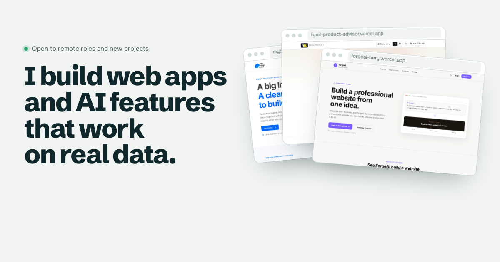

# Sadaqat Rasool, portfolio

My portfolio site: the projects I've shipped, how each one was built, my services for businesses, and my experience for companies hiring remotely.



## What's in it

- **Home**: what I build, a fan of live projects, proof in one sentence, selected work, and two paths: hiring me, or hiring me for a project.
- **Work**: every project, labelled honestly as paid client work, own product, working preview, open source or demo, each with a case study page (problem, what I built, stack, results, live link).
- **Services**: what businesses can hire me for, with starting prices and how a project runs.
- **About**: experience timeline, skills, education and public recommendations.
- **Contact**: email, LinkedIn, WhatsApp, GitHub and CV.

## Built with

- Next.js 15 (App Router, static generation for every page)
- React 19 and TypeScript (strict)
- Plain CSS with design tokens, light and dark themes
- Self-hosted fonts (Schibsted Grotesk and Onest), no external requests
- Security headers and a Content Security Policy in `next.config.mjs`
- Sitemap, robots.txt, Open Graph image and JSON-LD for search engines

Checked with Playwright on desktop and phone sizes (no horizontal overflow, no console errors) and with axe for WCAG 2 A/AA in both themes (no violations).

## Run it locally

```bash
npm install
npm run dev        # http://localhost:3000
npm run build      # production build
```

## Editing content

All text lives in `lib/content.ts`: projects, services, experience, skills and recommendations. Add a project there and its case study page, the work index and the sitemap update automatically. Screenshots go in `public/work/`.

To offer the CV as a download, put the PDF at `public/Sadaqat_Rasool_CV.pdf`. Until it's there, the site shows an email link instead.

## Deploy

Import the repository on Vercel and deploy with the default settings. Live at https://sadaqatrasool.vercel.app. Set `NEXT_PUBLIC_SITE_URL` if the domain changes so the sitemap and share links use it.

## Contact

sadaqatrasoolmsr@gmail.com · [LinkedIn](https://www.linkedin.com/in/sadaqatrasool/)
